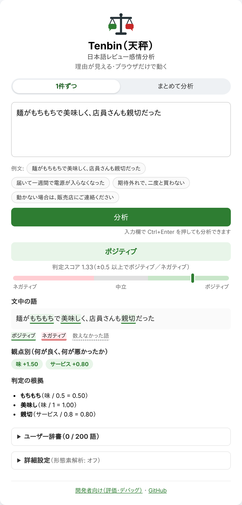

<p align="center"></p>

# Tenbin（天秤）— 日本語レビュー感情分析

**Explainable Japanese Review Sentiment Analyzer** — 理由が見える・ブラウザだけで動く

> 天秤のように、ポジティブとネガティブを**語ごとの重さが見える形で**量ります。量れないときは「判定できません」と正直に答えます。

> 🚀 現在のバージョン: v0.16.0（まとめて分析: 複数のレビューを1件ずつ分析して集計）

**▶ 今すぐ試す: https://bowo-prasetyo.github.io/japanese-sentiment-analyzer/#/**

<p align="center"></p>

---

## 🎯 これは何か

日本語の**レビュー文**を「ポジティブ／ネガティブ／中立」に判定するツールです。

* **理由が見える**: どの語が、どれだけ判定に効いたかを表示します。
* **何が良く何が悪かったかが分かる**: 味・品質・サービス・価格などの観点ごとに点数を出します。
* **ブラウザだけで動く**: 入力した文はどこにも送信されません。サーバも APIキーも要りません。

### English summary

Tenbin is a rule-based sentiment analyzer for Japanese product and restaurant reviews.
It runs entirely in the browser, shows which words drove each verdict, scores each review aspect
(taste, quality, service, price, …), and answers "cannot judge" instead of guessing when it finds no known words.
The documentation is in Japanese.

---

## 🚀 はじめかた（3ステップ）

1. [公開版](https://bowo-prasetyo.github.io/japanese-sentiment-analyzer/#/)を開き、レビューの文を入力します（「例文」を押しても試せます）。
2. 「分析」を押します。
3. 判定・観点別の点数・判定の根拠を確認します。

「判定できません」と表示されたら、その文の語がまだ辞書にありません。
画面下の**ユーザー辞書**に語を追加すると、判定できるようになります。

詳しい使い方は **[ユーザーガイド](docs/user-guide.md)** を見てください。

---

## 👥 誰のためのものか

| 対象 | 使い方 |
| --- | --- |
| レビュー分析を試作したい開発者 | サーバ・APIキー不要。辞書（JSON）を自分の分野に合わせて編集できる |
| 感情分析・自然言語処理を学ぶ人 | 判定の仕組みと根拠がすべて画面に出る |
| 判定理由の説明が必要な場面 | 「なぜその判定か」を語ごとに示せる |

---

## 📏 どのくらい正確か

辞書を見ていない作者が作った、固定のテスト用の文（[ベンチマーク b1](docs/evaluation.md#固定ブラインドベンチマーク)、150件）で測りました。

* ポジティブ・ネガティブの文の **87%** を判定できます。
* 判定できた文の **85.7%** が正解です。
* 残りの 13% は、辞書の語が見つからず「判定できません」になります。

数値は v0.15.0 で測ったものです。v0.16.0 では判定の仕組みと辞書を変えていないため、同じ結果になります。
測り方と詳しい数値は[評価](docs/evaluation.md)を見てください。

---

## 🚫 できないこと

* **皮肉・文脈・長い文章の論理**の理解（決まったルールで判定するため）
* **辞書にない表現**の判定（ユーザー辞書で補えます）
* SNS のスラング・絵文字、レビュー以外の文章（ニュース・会話など）
* 人物の評価・採用・与信など、**個人に影響する判断への利用**（推奨しません）

ほかの制限は[ユーザーガイドの「制限」](docs/user-guide.md#制限)にあります。

---

## 📚 ドキュメント

| 文書 | 読む人 | 内容 |
| --- | --- | --- |
| [ユーザーガイド](docs/user-guide.md) | 使う人 | 画面の使い方・結果の読み方・まとめて分析・ユーザー辞書・よくある質問 |
| [用語集](docs/glossary.md) | すべての人 | 判定スコア・極性・逆接・Macro-F1 などの意味 |
| [辞書のリファレンス](docs/dictionary.md) | 辞書を編集する人 | `data/config.json` の全項目・判定のしくみ・語彙の追加手順 |
| [評価](docs/evaluation.md) | 精度を確かめる人 | 指標・テストセット・ベンチマークと、その履歴 |
| [擬似API](docs/pseudo-api.md) | 開発者 | URL で分析結果の JSON を表示するページ |
| [開発への参加](CONTRIBUTING.md) | 開発者 | 手元での動かし方・テスト・CI・依存ライブラリの更新・ディレクトリ構成 |

---

## 💻 手元で動かす

ページはデータ（辞書の JSON）をネットワーク経由で読み込みます。
そのため `index.html` をファイルとして直接開いても動きません。リポジトリのフォルダでローカルサーバを起動してください。

```bash
python3 -m http.server
```

ブラウザで http://localhost:8000 を開きます（Windows では `python3` の代わりに `py` を使います）。

テスト・評価の実行方法は [CONTRIBUTING.md](CONTRIBUTING.md) にあります。

---

## 📜 ライセンス

MIT License。使用しているライブラリ（Vue・Vue Router・kuromoji.js・IPADIC）のライセンスは [THIRD_PARTY_NOTICES.md](THIRD_PARTY_NOTICES.md) を参照してください。

## 🙌 作者

Bowo Prasetyo（開発の支援: [ChatGPT](https://chatgpt.com/)）
