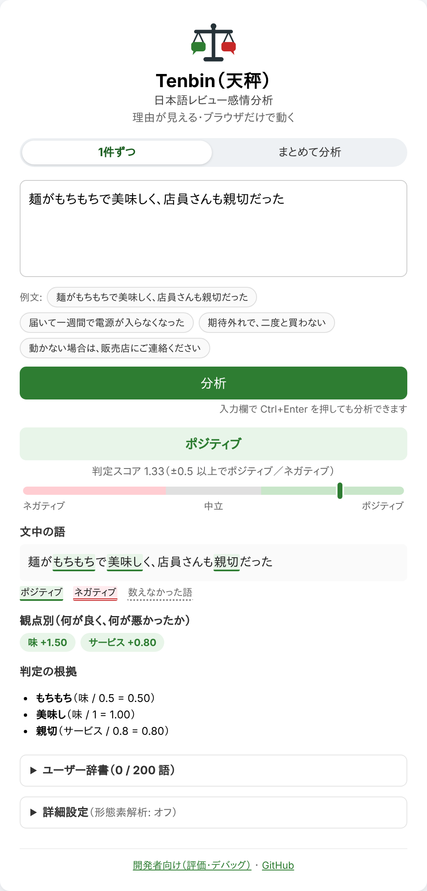
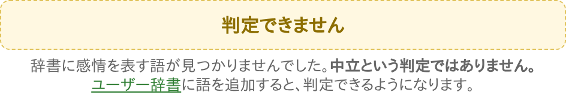
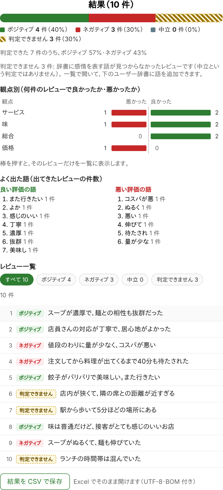

# ユーザーガイド

Tenbin（天秤）の画面の使い方と、結果の読み方を説明します。
分からない言葉は[用語集](glossary.md)を見てください。

## 目次

* [画面の種類](#画面の種類)
* [1件ずつ分析する](#1件ずつ分析する)
* [結果の読み方](#結果の読み方)
* [「判定できません」と表示されたとき](#判定できませんと表示されたとき)
* [まとめて分析する](#まとめて分析する)
* [ユーザー辞書に語を追加する](#ユーザー辞書に語を追加する)
* [詳細設定（形態素解析）](#詳細設定形態素解析)
* [プライバシー](#プライバシー)
* [よくある質問](#よくある質問)
* [制限](#制限)

---

## 画面の種類

画面は3つあります。上の「1件ずつ」「まとめて分析」で切り替えます。開発者向けの画面は、画面下のリンクから開きます。

| 画面 | URL | 使うとき |
| --- | --- | --- |
| 1件ずつ | [`#/`](https://bowo-prasetyo.github.io/japanese-sentiment-analyzer/#/) | 1件のレビューを、根拠まで詳しく見る |
| まとめて分析 | [`#/bulk`](https://bowo-prasetyo.github.io/japanese-sentiment-analyzer/#/bulk) | 複数のレビューを分析して、全体の傾向を見る |
| 開発者向け | [`#/dev`](https://bowo-prasetyo.github.io/japanese-sentiment-analyzer/#/dev) | 「1件ずつ」の内容に加えて、結果の JSON とテスト評価を見る |

---

## 1件ずつ分析する

1. 入力欄にレビューの文を入力します。例文のボタンを押すと、例文が入力されてすぐに分析されます。
2. 「分析」を押します。入力欄で **Ctrl+Enter**（Mac は **⌘+Enter**）を押しても分析できます。
3. 下に結果が表示されます。スマホなどでは、結果の位置まで自動でスクロールします。

> **入力を変えたとき**: 分析したあとに入力を変えると、結果が灰色の点線の枠で表示され、「入力が変わりました」と案内が出ます。
> 表示中の結果は前の文のものです。「分析」を押すと更新されます。

> **入力が空のとき**: 分析はせず、文を入力するよう案内します。

> **辞書の読み込み中**: 「分析」ボタンは「辞書を読み込み中…」と表示され、押せません。
> 読み込みに失敗したときは理由と「再読み込み」ボタンが表示されます。

---

## 結果の読み方

例: 「麺がもちもちで美味しく、店員さんも親切だった」



結果は上から次の順に表示されます。

| 表示 | 意味 |
| --- | --- |
| **判定** | ポジティブ／ネガティブ／中立／判定できません |
| **判定スコア** | 判定に使う数値です（例: 1.33）。+0.5 以上ならポジティブ、−0.5 以下ならネガティブ、その間なら中立です |
| **メーター** | 判定スコアの位置を示します。目盛りは −2〜+2 で、外側の値は端に表示します |
| **文中の語** | 判定に使った語に印を付けます。緑の下線はポジティブ、赤の二重下線はネガティブ、灰色の点線は数えなかった語です |
| **観点別** | 味・品質・サービス・価格などの観点ごとの点数です。影響の大きい順に並びます |
| **感情・評価** | 喜び・怒り・不安などの感情ごとの点数です |
| **判定の根拠** | 判定に使った語と、その点数の計算です（下で説明します） |
| **数えなかった語** | 辞書にあるが数えなかった語と、その理由です |

### 判定の根拠の読み方

根拠は次の形で表示されます。

```
語（カテゴリ / 辞書の点数 → 否定したときの点数 ×強調の倍率 = 最終の点数）
```

| 表示 | 例 | 意味 |
| --- | --- | --- |
| `美味し（味 / 1 = 1.00）` | 美味しい | 辞書の点数をそのまま使った |
| `美味し（味 / 1 → -1 否定 = -1.00）` | 美味しくない | 後ろに否定（〜ない）があるので符号を反転した |
| `美味し（味 / 1 ×1.5 = 1.50）` | とても美味しい | 前に強調の語（とても）があるので 1.5 倍にした |
| `眠れ（結果 / 否定 → -0.8 = -0.80）` | 眠れなかった | 否定されたときだけ数える語（下の注を参照） |
| **ユーザー** の印 | — | ユーザー辞書で追加した語 |

注: 「眠れる」「効く」「動く」のように、できて当たり前のことを表す語は、
否定されたとき（眠れなかった）だけ不満として数えます。肯定の形（眠れた）は数えません。

### 判定スコアの計算

**判定スコア = 数えた語の点数の合計 ÷ √（数えた語の数）**

語の数が多い文ほど合計が大きくなりすぎないように、語の数の平方根で割ります。
例の文では、合計 0.5 + 1 + 0.8 = 2.3、語は3つなので 2.3 ÷ √3 ≈ 1.33 です。

### 数えない語

次の語は、辞書にあっても判定に使いません。「数えなかった語」に理由と一緒に表示します。

| 理由 | 例 | なぜ数えないか |
| --- | --- | --- |
| 逆接より前 | 接客は**丁寧**だったけど、駐車場が狭い | 「けど」「のに」などの後ろが書き手の言いたいことなので、後半だけで判定する |
| 条件 | **動かない**場合は、販売店にご連絡ください | 実際の体験ではない |
| 説明 | **眠れない**夜のための枕 | 対象の説明であり、評価ではない |
| 用法 | **よく**壊れる | 「よく」が「良く」ではなく「頻繁に」の意味 |

ほかに、次の場合も数えません（「数えなかった語」には表示しません）。

* **同じ語の2回目以降**: 同じ語は何度出ても1回だけ数えます。文中の印も最初の1か所だけに付きます。
* **長い語の一部**: 「期待外れ」が見つかったら、その中の「期待」は数えません。

---

## 「判定できません」と表示されたとき



「判定できません」は、**判定に使える語が1つもなかった**という意味です。
「感情がない（中立）」という判定ではありません。

画面には、次のどれに当たるかが表示されます。

| 表示される理由 | よくある例 | すること |
| --- | --- | --- |
| 辞書に感情を表す語が見つからなかった | 分野に特有の言い方（「コシがある」など） | ユーザー辞書に語を追加する |
| 逆接（けど・のに など）の後半に評価の語がない | 「味は良かったけど、駅から遠い」の「遠い」が辞書にない | 後半の語をユーザー辞書に追加する |
| 見つかった語が、条件・説明の中にあるか別の意味で使われていた | 「動かない場合は〜」 | 多くの場合、そのままで正しい（体験ではないため） |
| 見つかった語が、ポジティブにもネガティブにも働かない語だけだった | 「驚いた」 | 必要ならユーザー辞書で点数を付ける |

「ユーザー辞書」のリンクを押すと、画面下のユーザー辞書が開きます。

---

## まとめて分析する

複数のレビューを1件ずつ分析して、全体を集計します。

### 手順

1. 上の「まとめて分析」を押します。
2. レビューを入れます。方法は2つあります。
   * **貼り付ける**: 1行に1件で貼り付けます。空行があれば、空行で区切ったまとまりを1件とします。
     区切り方は「区切り方」で変えられます。行の先頭の「・」「1.」などの印は取り除きます。
   * **ファイルを読み込む**: 「ファイルを読み込む」で `.txt` か `.csv` を選びます（5MB まで）。
   * 試すだけなら「例を入れる」を押します。
3. CSV のときは、「レビューの列」で分析する列を確かめます（下の注を参照）。
4. 入力欄の下に「◯件のレビューとして分析します」と表示されるので、件数を確かめます。
5. 「まとめて分析」を押します。

* **件数の上限**: 1000件までです。超えた分は分析せず、その件数を表示します。
* **CSV の列の選び方**: 見出し（レビュー・口コミ・本文・コメント・review など）から自動で選びます。
  見出しがなければ、平均の文字数がいちばん長い列を選びます。
* **文字コード**: UTF-8 で読めないファイルは Shift_JIS（Excel で保存した日本語の CSV）として読みます。

### 結果の見方



| 表示 | 内容 |
| --- | --- |
| **件数** | ポジティブ／ネガティブ／中立／判定できません の件数と割合。帯グラフの斜線の部分が「判定できません」 |
| **観点別** | 観点ごとに、良かったレビューと悪かったレビューの**件数**。棒を押すと、そのレビューだけを一覧に表示 |
| **よく出た語** | 良い評価・悪い評価の根拠になった語と、その語が出てきたレビューの件数 |
| **レビュー一覧** | 判定のボタンで絞り込めます。行を押すと、文中の語の印と根拠を表示します。「1件ずつの画面で詳しく見る」で、そのレビューを1件ずつの画面で開きます |

### CSV で保存する

「結果を CSV で保存」を押すと、次の列の CSV を保存します。
UTF-8（BOM 付き）なので、Excel でそのまま開けます。

番号・レビュー・判定・判定スコア・良かった観点・悪かった観点・根拠の語

### 注意

* ユーザー辞書と詳細設定は「1件ずつ」の画面と共通です。変えると、表示中の結果を分析し直します。
* ユーザー辞書の「追加する前の確認」は、一覧で開いているレビューで行います。
* **URL からレビューを取得する機能はありません。** レビューを貼り付けるか、ファイルを読み込んでください（理由は[よくある質問](#url-を入れてレビューを取得できませんか)を参照）。

---

## ユーザー辞書に語を追加する

組み込みの辞書にない語を、自分で追加できます。

### 手順

1. 画面下の「ユーザー辞書」を開きます。
2. 「語」に、**活用しても変わらない部分**を入力します。
   例: 「コシがある」なら「コシがあ」（「コシがあった」「コシがあって」にも一致します）。
3. 入力欄の下に、上で入力中の文でその語がどう扱われるかが表示されます。確かめてから追加します。
4. 「極性」に点数を入れます。目安は、ほめ言葉が 0.5〜1.0、不満が −0.5〜−1.0 です（範囲は −1.5〜+1.5、0 は不可）。
5. 「カテゴリ」を選びます。観点（味・品質・サービス…）を選ぶと、観点別の点数に反映されます。
   どれにも当たらなければ「ユーザー辞書」を選びます。
6. 「追加」を押します。表示中の結果は、すぐに分析し直されます。

### 追加する前の確認の見方

| 表示 | 意味 |
| --- | --- |
| ✓ 判定に使われます | 文の中で見つかり、判定に使われる。否定されていれば、その点数も表示 |
| △ 見つかりますが、数えません | 条件・説明・逆接の前などにあるため数えない（理由つき） |
| △ …の一部として扱われるため、使われません | より長い辞書の語の一部になっている |
| ✗ 見つかりません | 文の中にその語がない |

入力した語に応じて、次の案内も出ます。

* **活用した形で入力したとき**（「コシがある」など）: 変わらない部分（「コシがあ」）を候補として出します。ボタンを押すと置き換わります。
* **否定の形で入力したとき**（「美味しくない」など）: 否定は自動で判定されるので、肯定の形で登録するよう案内します。
* **1文字の語のとき**: ほかの語の一部に一致しやすいため、注意を表示します。

### 知っておくこと

* **保存先はこのブラウザだけ**です（最大200語）。ブラウザのデータを消すと、ユーザー辞書も消えます。
  プライベートモードなど保存できない環境では、ページを閉じると消えます（追加したときに表示されます）。
* **残す・別の端末で使う・共有する**ときは、「書き出し（JSON）」で保存し、「読み込み（JSON）」で読み込みます。
  読み込むと、追加・更新した語の数と、上限や形式の誤りで取り込めなかった語の数を表示します。
* **組み込みの辞書と同じ語を登録すると、ユーザーの指定が優先されます**（組み込みの特別なルールも外れます）。
* 否定・強調・条件の除外などのルールは、ユーザー辞書の語にも同じように効きます。
* 削除した直後は「元に戻す」で元の位置に戻せます（次に追加・読み込み・削除をするまで）。
* 語は空白なし・20文字以内です。
* ユーザー辞書は、開発者向けの画面のテスト評価には使いません。

---

## 詳細設定（形態素解析）

画面下の「詳細設定」で、「形態素解析を使う」をオンにできます。ふだんはオフのままで構いません。

* **何が変わるか**: 文を単語に分けて、否定（「少ない」の「ない」は否定ではない、など）と語の区切りをより正確に見分けます。
* **注意**: オンにすると、約18MB の辞書をダウンロードします。
* **精度**: いまの辞書では、精度はほとんど変わりません（[評価](evaluation.md#形態素解析の効果)を参照）。
* 読み込み中・読み込みに失敗したときは、オフのとき（文字列モード）で分析し、状態を表示します。
* 設定はこのブラウザに保存されます。

---

## プライバシー

* 入力した文は、**どの画面でも**このブラウザの中だけで分析します。どこにも送信しません。
* ネットワークから読み込むのは、ページ・辞書のファイルと、形態素解析をオンにしたときの辞書だけです。
* ユーザー辞書と詳細設定は、このブラウザに保存します。

---

## よくある質問

### 「中立」と「判定できません」は何が違いますか

* **中立**: 判定に使える語が見つかり、その点数がプラスとマイナスで打ち消し合ったか、小さかった（判定スコアが −0.5 と +0.5 の間）。
* **判定できません**: 判定に使える語が1つもなかった。感情があるかどうか分からない、という意味です。

### 判定が間違っています

「判定の根拠」と「数えなかった語」を見て、原因を確かめてください。

| 原因 | 例 | 対処 |
| --- | --- | --- |
| 語が辞書にない | 分野に特有の言い方 | ユーザー辞書に追加する |
| 語の点数が合わない | 自分の分野では悪い意味の語 | ユーザー辞書で同じ語を登録し直す（ユーザーの指定が優先される） |
| ルールで扱えない表現 | 皮肉、二重否定、多義語 | 対処できません（[制限](#制限)を参照） |

### 「けど」の前の良いことが無視されます

仕様です。「〜けど」「〜のに」「しかし」などの後ろが、書き手の言いたいことであることが多いため、後半だけで判定します。
前半の語は「数えなかった語」に表示します。

### ユーザー辞書が消えました

ユーザー辞書はブラウザに保存しているため、ブラウザのデータを消したり、別のブラウザ・端末で開いたりすると表示されません。
「書き出し（JSON）」で保存しておき、「読み込み（JSON）」で戻してください。

### 形態素解析はオンにしたほうがいいですか

ふだんはオフで十分です。いまの辞書ではオンにしても精度はほとんど変わらず、約18MB のダウンロードが必要になります。

### URL を入れてレビューを取得できませんか

できません。理由は次の2つです。

* ブラウザだけでは、ほかのサイトのページを読み込めません（ブラウザの安全のしくみ）。読み込むにはサーバが必要です。
* 多くのレビューサイトは、利用規約で自動の取得を禁止しています。

### 長い文章を「1件ずつ」の画面にまとめて入れてもいいですか

おすすめしません。判定のしくみは1件のレビューのためのものです。長い文章を1件として入れると、
最初の「けど」などより前がすべて数えられず、同じ語は何度出ても1回しか数えません。
複数のレビューは「まとめて分析」を使ってください。

---

## 制限

* **二重否定**は扱えません（例: 「嬉しくないわけではない」はネガティブになる）。
* **文脈・皮肉**は理解しません。
* **多義語**を区別できないことがあります（例: 「おすすめを聞いた」「好きな色を選んで」もポジティブになる）。
* **否定が遠い表現**は検出できないことがあります。否定は語の後ろ8文字までしか見ません
  （「二度と…ない」など一部の表現は、語ごとに範囲を広げています）。
* 「よく止まる」「よく固まる」のように、**不満が動詞の側にある文**は、動詞が辞書になければ中立になることがあります。
* **強調の語がどの語にかかるか**があいまいな場合があります。
